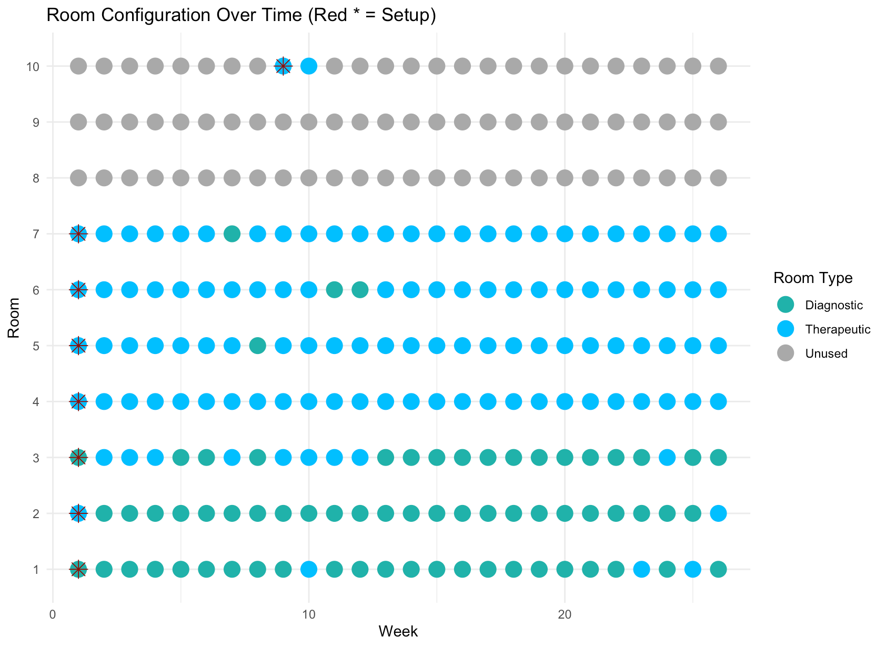
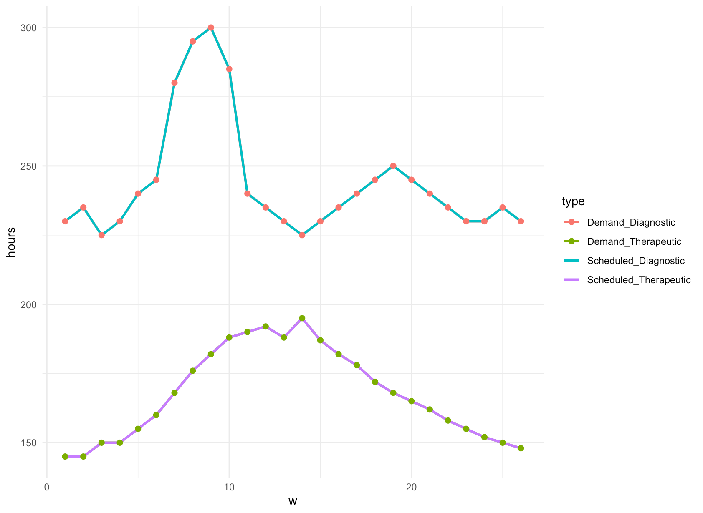
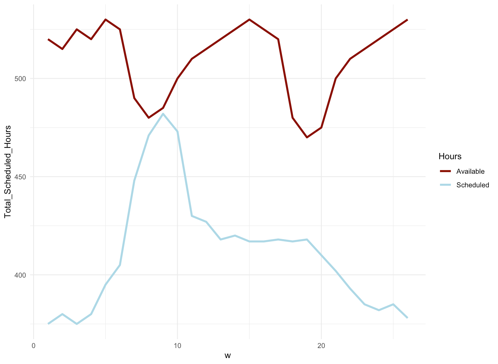
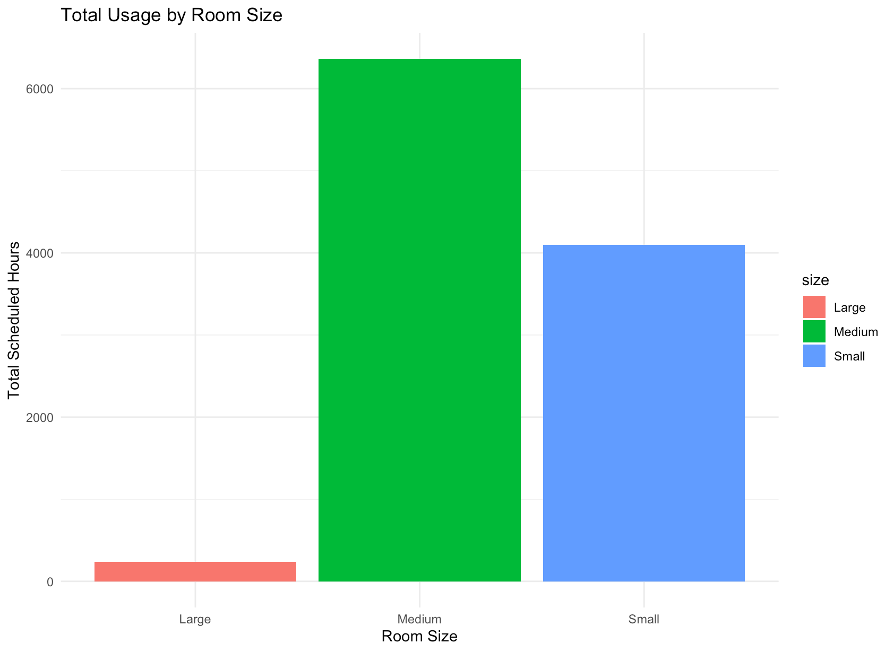
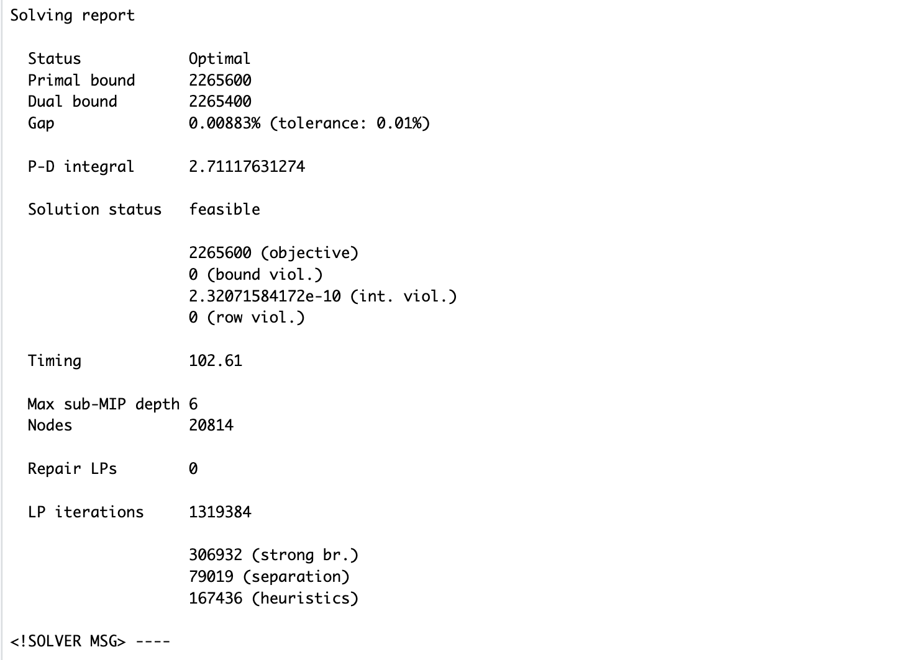

# Endoscopy Capacity Planning with Mixed-Integer Linear Programming

**MSc Business Analytics: Data-Driven Decision Making, Queen's Business School, Queen's University Belfast**
**Author:** Ria Goel  ·  **Tools:** R · `ompr` · `ROI` · **HiGHS** MILP solver · dplyr · ggplot2 · gt

> A hospital gastroenterology (GI) unit has **10 endoscopy rooms of three sizes** and must meet weekly diagnostic and therapeutic demand for **26 weeks** without exceeding clinician hours. Each week it has to decide which rooms to open, what to use them for, and how many hours to schedule in each, at the lowest total cost. This project formulates the problem as a **Mixed-Integer Linear Program (MILP)** and solves it to proven optimality.

---

## Key results at a glance

| | Result |
|---|---|
| **Model size** | 1,300 decision variables (780 binary, 520 continuous) and 9 constraint families over 10 rooms × 26 weeks |
| **Optimal cost** | **2,265,600** for the 26-week plan |
| **Optimality** | Primal 2,265,600 vs dual bound 2,265,400, a **MIP gap of 0.0088%**. Solved by HiGHS in about 183 s |
| **Feasibility** | Demand met in every week, and clinician hours never exceeded |
| **Room strategy** | The 7 small and medium rooms run all 26 weeks. Large rooms stay closed apart from **one large room opened for weeks 9–10**, when diagnostic demand peaks |
| **Flexibility** | Most active rooms are set up for therapeutic work, which can also handle diagnostic procedures, so no extra setup costs are needed |

---

## The problem

| Room size | Rooms | Diagnostic capacity (hrs/wk) | Therapeutic capacity (hrs/wk) | Setup cost | Cost per hour |
|---|---|---|---|---|---|
| Small | 1–3 | 60 | 30 | 15,000 | 180 |
| Medium | 4–7 | 120 | 60 | 20,000 | 200 |
| Large | 8–10 | 180 | 120 | 25,000 | 220 |

- **Weekly demand** varies: 225–300 diagnostic hours and 145–195 therapeutic hours. **Clinician availability** varies between 470 and 530 hours per week.
- Each week, a room is either **diagnostic** (diagnostic work only), **therapeutic** (both types) or **unused**.
- Opening a room (moving from unused to active) incurs a **fixed setup cost**, so switching rooms on and off is expensive.

## Mathematical formulation

**Indices:** rooms *r* ∈ {1..10}, weeks *w* ∈ {1..26}

**Decision variables**
- `x_diag[r,w]`, `x_thera[r,w]` ∈ {0,1}: whether room *r* is configured as diagnostic or therapeutic in week *w*
- `y[r,w]` ∈ {0,1}: whether a setup (room opening) happens
- `d[r,w]`, `t[r,w]` ≥ 0: diagnostic and therapeutic hours scheduled

**Objective:** minimise operating cost plus setup cost

$$\min Z = \sum_{w=1}^{26}\sum_{r=1}^{10}\Big(A_r B^{diag}_r\,x^{diag}_{r,w} + A_r B^{thera}_r\,x^{thera}_{r,w} + S_r\,y_{r,w}\Big)$$

**Constraints**
1. **One mode per room per week:** `x_diag + x_thera ≤ 1`
2. **Diagnostic demand** must be met each week.
3. **Therapeutic demand** must be met each week.
4. **Eligibility:** therapeutic hours can only be scheduled in therapeutic rooms, up to their therapeutic capacity.
5. **Room capacity:** total hours in a room can't exceed the capacity of its configuration.
6. **Clinician hours:** total weekly hours can't exceed the clinician hours available.
7. **Week 1 setup:** any room used in week 1 incurs a setup.
8. **Setup detection:** a setup is triggered when a room goes from unused in week *w−1* to active in week *w*.
9. **Setup only if active:** no setup cost is charged for a room that isn't used.

## Results



*Rooms 1–7 stay open for the whole horizon, and setup costs are paid only once, in week 1. Room 10 opens briefly for the peak in weeks 9–10, and rooms 8–9 are never needed.*

 

*Left: scheduled hours track demand for both procedure types. Right: scheduled hours stay below clinician availability, coming closest around week 9.*

 

## Managerial recommendations
- **Keep a stable core of small and medium rooms open** and treat large rooms as surge capacity. Setup costs reward stability over frequent reconfiguration.
- **Default rooms to the therapeutic configuration** where possible. It handles both procedure types, which gives flexibility at no extra setup cost.
- **Plan staffing for peak weeks.** The near-capacity period (weeks 8–10) is when extra or temporary clinician capacity matters most.

## Part 2: Critical review of a published MILP application
The report also reviews **Hua et al. (2023)**, *"Research on outpatient capacity planning combining lean thinking and integer linear programming"* (*BMC Medical Informatics and Decision Making*). The paper uses a MILP solved with **IBM CPLEX (branch-and-cut)** to rebalance patients between doctors, minimising the maximum doctor working time. The review covers:
- the model's decision variables, objective and constraints
- how branch-and-cut works, starting from the LP relaxation and adding branching and cutting planes, and why it suits integer patient allocation
- reported gains of about 25% in senior doctor efficiency and about 50% in associate senior doctor capacity
- **limitations:** free reassignment of patients ignores specialisation and continuity of care, consultation times are treated as fixed, and the single objective ignores multiple goals. It suggests stochastic and multi-objective extensions.

## Repository structure

```
├── README.md
├── code/
│   └── endoscopy_capacity_milp.R   # Full model: data, formulation, solve, results tables & plots
├── figures/                        # Solver report and result visualisations
└── reports/
    └── Data_Driven_Decision_Making_Report.pdf
```

## How to run
All the input data is defined inside the script, so no external files are needed.

```r
install.packages(c("ompr", "ompr.roi", "ROI", "ROI.plugin.highs",
                   "dplyr", "tidyr", "ggplot2", "gt"))
```

Then run `code/endoscopy_capacity_milp.R`. The script was run in RStudio with `gt` and `tidyr` already loaded in the session, so add `library(gt)` and `library(tidyr)` if you run it in a fresh session. Solving takes a few minutes.

## Skills demonstrated
`Operations research` · `mathematical optimisation` · `mixed-integer linear programming (MILP)` · `model formulation` · `R` · `ompr` · `HiGHS solver` · `capacity planning` · `healthcare operations` · `scheduling` · `data visualisation` · `critical appraisal of OR literature`

---

*AI assistance was used for debugging and structuring parts of the code, as noted in the code comments.*
